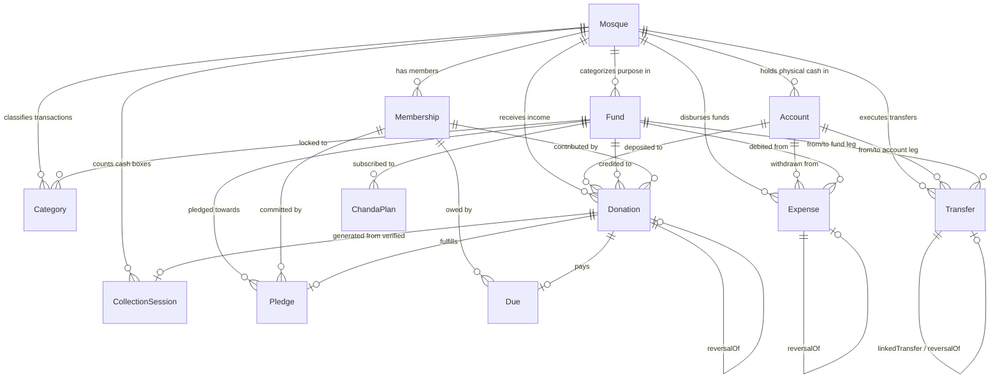

# System-Wide Technical Audit: Mashjid Hisab

**Scope:** Read-Only Architectural & Security Audit of Frontend (`mashjid-hisab-frontend`) and Backend (`mashjid-hisab-backend`).  
**Audit Date:** October 11, 2026  
**Auditor:** Antigravity System Architect  

---

## 1. Folder Structure and Routing Map

### 1.1 Frontend Routing Map (`Next.js 16.4.0 App Router`)

| Route | Path | Description & Features | Access / Role Restriction |
|---|---|---|---|
| **Public Landing** | `/` | Product landing page, feature showcase, FAQ, pricing | Public |
| **Login** | `/login` | Email/phone and password sign-in with toggle password visibility | Public (Guest only) |
| **Registration** | `/register` | Mosque administrator account registration | Public (Guest only) |
| **Forgot Password** | `/forgot-password` | Request password reset token via email | Public |
| **Reset Password** | `/reset-password` | Set new password using token | Public |
| **Force Password Change** | `/change-password` | Mandatory screen for users with `mustChangePassword: true` | Authenticated |
| **Verify Email** | `/verify-email` | Token confirmation link handler | Public |
| **Mosque Selector** | `/mosques` | Lists user's active mosque memberships; allows switching tenant | Authenticated |
| **New Mosque** | `/mosques/new` | Onboarding wizard to provision a new mosque tenant | Authenticated |
| **Executive Dashboard** | `/mosques/[mosqueId]/dashboard` | Executive KPI overview (Treasury balance, monthly income/spending, pending queue), quick actions, accounts & funds overview | `OVERSIGHT_ROLES` (Admin, Treasurer, Committee); Member sees Giving Portal |
| **Master Ledger & Queue** | `/mosques/[mosqueId]/transactions` | Dual-tab master ledger: Tab 1 = Full Immutable Ledger; Tab 2 = Dual-Control Approval Queue | Tab 1: All roles; Tab 2: `FINANCIAL_OPERATOR_ROLES` (Admin, Treasurer) |
| **Income Donations** | `/mosques/[mosqueId]/donations` | Record donor gifts, receipt generation, PDF print, cancellation/voiding | Record: `COLLECTION_OPERATOR_ROLES` (Admin, Treasurer, Staff); Void: Admin |
| **Expense Disbursements** | `/mosques/[mosqueId]/expenses` | Record vendor bills/utilities, voucher print, over-limit approval workflow | Record: `EXPENSE_OPERATOR_ROLES`; Approve/Void: Admin |
| **Inter-Account Transfers** | `/mosques/[mosqueId]/transfers` | Transfer between accounts (intra-fund) and between funds (fund-to-fund) | Admin & Treasurer (fund-to-fund: Admin only) |
| **Box Counting Sessions** | `/mosques/[mosqueId]/collections` | In-person physical cash box counting (Jummah, Eid, Taraweeh), dual-person verification | Create: Staff/Treas/Admin; Verify: Distinct second Admin/Treasurer |
| **Chanda & Dues** | `/mosques/[mosqueId]/chanda` | Recurring monthly Chanda contribution plans & monthly dues generation | Admin & Treasurer |
| **Pledges** | `/mosques/[mosqueId]/pledges` | Donor pledges, installment progress, and fulfillment linking | View: All; Record: Member (self), Admin/Treas (anyone) |
| **Campaigns** | `/mosques/[mosqueId]/campaigns` | Special capital/welfare fundraising drives with target meters | View: All; Manage: Admin/Treasurer |
| **Chart of Accounts** | `/mosques/[mosqueId]/accounts` | Cash safes, bank accounts, mobile wallets; account reconciliation | View: `OVERSIGHT_ROLES`; Manage/Reconcile: `FINANCIAL_OPERATOR_ROLES` |
| **Accounting Funds** | `/mosques/[mosqueId]/funds` | General vs Restricted funds (Zakat, Sadaqah, Construction) | View: `OVERSIGHT_ROLES`; Manage: Admin |
| **Categories** | `/mosques/[mosqueId]/categories` | Chart of income/expense classifications; fund category locks | View: `OPERATIONAL_ROLES`; Manage: Admin |
| **Members Directory** | `/mosques/[mosqueId]/members` | Membership list, role promotions/demotions, invite link generation | Admin & Treasurer |
| **Families & Households** | `/mosques/[mosqueId]/families` | Family units, household head assignments, family pledges | Admin & Treasurer |
| **Financial Reports** | `/mosques/[mosqueId]/reports` | Financial statements, monthly net surplus, donor rankings, CSV/PDF exports | `OVERSIGHT_ROLES` |
| **Member Giving Portal** | `/mosques/[mosqueId]/me` | Personal contribution records, tax receipts, pledge statuses, dues | Authenticated Member |
| **Audit Logs** | `/mosques/[mosqueId]/audit-logs` | Tamper-evident operational audit trail | Admin |
| **Mosque Settings** | `/mosques/[mosqueId]/settings` | Profile, address, timezone, fiscal year start, transparency page toggle | Admin |
| **Public Transparency** | `/m/[slug]` | Read-only public portal showing aggregated fund balances, income, campaigns | Public (when enabled in settings) |
| **Public Receipt Verify** | `/verify-receipt/[code]` | QR code receipt verification page confirming authenticity | Public |

---

### 1.2 Backend API Architecture (`Express 5.x + TypeScript + Prisma 7.x`)

Base route: `/api`

```
src/
├── app.ts                          # Express app configuration, CORS, BigInt JSON serializer
├── server.ts                       # HTTP listener & process lifecycle
├── config/                         # Environment & Prisma client setup
├── middlewares/
│   ├── auth.middleware.ts          # JWT authentication, token extraction, SuperAdmin guard
│   ├── mosque.middleware.ts        # Tenant extraction, DB membership validation, role guards
│   ├── globalErrorHandler.ts      # Structured API error formatting & status mapping
│   ├── notFound.ts                # 404 handler
│   └── rateLimiter.middleware.ts  # In-memory IP/user rate limiter
├── routes/
│   └── index.ts                    # Root router mounting all module routers under /api
└── modules/
    ├── auth/                       # Login, Register, Refresh Token, Password Reset
    ├── user/                       # User profile, password management
    ├── mosque/                     # Mosque tenant CRUD, settings, archival
    ├── membership/                 # Tenant memberships, roles, invitations
    ├── account/                    # Physical accounts, bank accounts, reconciliation
    ├── fund/                       # Accounting funds (General, Zakat, etc.)
    ├── category/                   # Income and Expense categories
    ├── donation/                   # Donations, receipts, voiding/reversals
    ├── expense/                    # Disbursements, payment vouchers, voiding/reversals
    ├── transfer/                   # Inter-account and fund-to-fund paired transfers
    ├── transaction/                # Unified ledger API, dual-control approval queue
    ├── collection/                 # Box counting sessions, 2-person verification
    ├── campaign/                   # Fundraising campaigns & goal meters
    ├── pledge/                     # Member donor commitments & fulfillments
    ├── chanda/                     # Chanda plans and monthly dues generation
    ├── me/                         # Member self-service contribution portal
    ├── report/                     # Dashboard report, statements, CSV exports
    ├── invite-link/                # Public registration invite links
    ├── transparency/               # Public read-only transparency endpoints
    ├── attachment/                 # File upload and signed download URLs
    └── audit/                      # Financial compliance audit logging
```

---

## 2. Data Model Analysis

The database schema is modularized across 20 `.prisma` files in `prisma/schema/`.



### 2.1 Accounts vs. Funds (Two-Dimensional Accounting)
- **Account (`model Account`)**: Represents **WHERE** money physically or digitally resides (e.g., `Cash Box`, `Islami Bank A/C`, `bKash Merchant`). Fields: `id`, `mosqueId`, `name`, `type` (`CASH`, `BANK`, `MOBILE_WALLET`, `CARD`, `OTHER`), `accountNumber`, `openingBalance` (`BigInt`), `isArchived`.
- **Fund (`model Fund`)**: Represents **WHY** money exists (its Shariah or operational restriction). Fields: `id`, `mosqueId`, `name`, `type` (`GENERAL`, `ZAKAT`, `SADAQAH`, `CONSTRUCTION`, `MADRASA`, `QURBANI`, `WAQF`, `IFTAR`, `OTHER`), `isRestricted` (`Boolean`), `description`, `isArchived`.
- **Relationship**: Accounts and Funds are orthogonal. A single physical bank account can concurrently hold money belonging to multiple funds (e.g. ৳50,000 in Islami Bank may comprise ৳30,000 General Fund and ৳20,000 Zakat Fund).

### 2.2 Transactions & Immutability
- **Donation (`model Donation`)**: Inflow transaction. Fields: `amount` (`BigInt`), `accountId`, `fundId`, `categoryId`, `date`, `memberId`, `familyId`, `donorName`, `isAnonymousPublic`, `receiptNumber`, `status` (`PENDING`, `POSTED`, `REJECTED`, `VOIDED`), `reversalOfId`.
- **Expense (`model Expense`)**: Outflow transaction. Fields: `amount` (`BigInt`), `accountId`, `fundId`, `categoryId`, `date`, `payee`, `voucherNo`, `status` (`PENDING`, `PENDING_APPROVAL`, `POSTED`, `REJECTED`, `VOIDED`), `reversalOfId`.
- **Transfer (`model Transfer`)**: Relocation of funds or cash. Always creates two atomic legs (`leg: FROM` and `leg: TO`) sharing a single `transferNumber` and referencing each other via `linkedTransferId`.

### 2.3 Approvals & Dual-Control Governance
- Staff entries are created with `status: PENDING`.
- Expenses exceeding the mosque's `expenseApprovalLimit` (configured on `Mosque`) recorded by Treasurers enter `status: PENDING_APPROVAL`.
- Self-approval is strictly prohibited: `createdById === approverId` triggers `SELF_APPROVAL_NOT_ALLOWED`.
- Collection sessions require a distinct second counter/verifier (`verifiedById !== createdById`).

### 2.4 Members, Families, and Pledges
- **Membership (`model Membership`)**: Scoped per mosque (`@@unique([userId, mosqueId])`). Roles: `MOSQUE_ADMIN`, `TREASURER`, `COMMITTEE_MEMBER`, `STAFF`, `MEMBER`.
- **Family (`model Family`)**: Group of household members headed by a designated `headMembershipId`.
- **Pledge (`model Pledge`)**: Moral commitment to pay a sum towards a fund or campaign by a due date.
- **ChandaPlan (`model ChandaPlan`) & Due (`model Due`)**: Recurring monthly contribution plans generating monthly receivables (`Due`).

---

## 3. Discrepancy in Pending-Approval Counts (Dashboard Card vs. Banner)

### 3.1 The Problem
On the mosque dashboard, users have observed that the **Pending Approvals KPI card** and the **Pending Approvals alert banner** display conflicting numbers, or show items that do not appear in the transaction approval queue.

### 3.2 Root Cause in Code
The discrepancy originates from **three distinct architectural inconsistencies** across backend calculations and frontend presentation:

#### Issue A: Inclusion of `openCollections` in `totalPending`
In [`src/modules/report/report.service.ts`](file:///home/sojib-ahmed/Projects%20/mashjid-hisab/mashjid-hisab-backend/src/modules/report/report.service.ts#L232-L266):
```typescript
const [
  pendingDonations,
  pendingExpenses,
  openCollections,
  pendingDonationsSum,
  pendingExpensesSum,
] = await Promise.all([
  prisma.donation.count({ where: { mosqueId, status: DonationStatus.PENDING } }),
  prisma.expense.count({ where: { mosqueId, status: { in: [ExpenseStatus.PENDING, ExpenseStatus.PENDING_APPROVAL] } } }),
  prisma.collectionSession.count({ where: { mosqueId, status: CollectionStatus.OPEN } }), // <-- Open physical box counting sessions
  ...
]);

return {
  pendingApprovals: {
    pendingDonations,
    pendingExpenses,
    openCollections,
    totalPending: pendingDonations + pendingExpenses + openCollections, // <-- Sum includes open collections
    totalPendingAmount: totalPendingAmount.toString(),
  }
}
```

#### Issue B: Banner Text Omits Open Collections and Amount Mismatch
In [`src/app/mosques/[mosqueId]/dashboard/page.tsx`](file:///home/sojib-ahmed/Projects%20/mashjid-hisab/mashjid-hisab-frontend/src/app/mosques/%5BmosqueId%5D/dashboard/page.tsx#L166-L186):
- **KPI Card** displays: `pendingCount = totalPending` (e.g., `1`).
- **Banner Heading** displays: `{totalPending} Pending Approvals Awaiting Action` (e.g., `1`).
- **Banner Subtitle** states:
  ```tsx
  {dashboardData?.pendingApprovals?.pendingDonations || 0} donations, {dashboardData?.pendingApprovals?.pendingExpenses || 0} expenses totaling {formatCurrency(totalPendingAmount)}
  ```
- **The Discrepancy:** If `openCollections === 1`, `pendingDonations === 0`, and `pendingExpenses === 0`:
  - The card says **1**.
  - The banner heading says **1 Pending Approval Awaiting Action**.
  - The banner subtext says **0 donations, 0 expenses totaling ৳0.00**.
  - Open collections have no finalized monetary amount until counted/verified, so `totalPendingAmount` does not include them.

#### Issue C: Approval Queue Endpoint Omits Collection Sessions
Clicking "Review" or "Review Pending Queue" navigates to `/mosques/${mosqueId}/transactions?tab=pending`.  
That page queries `GET /api/mosques/${mosqueId}/transactions/pending`.  
In [`src/modules/transaction/transaction.service.ts`](file:///home/sojib-ahmed/Projects%20/mashjid-hisab/mashjid-hisab-backend/src/modules/transaction/transaction.service.ts#L854-L975), `getPendingTransactions` queries:
- `prisma.donation.findMany({ where: { status: DonationStatus.PENDING } })`
- `prisma.expense.findMany({ where: { status: { in: [ExpenseStatus.PENDING, ExpenseStatus.PENDING_APPROVAL] } } })`
- **It NEVER queries `CollectionSession`!**
- **Outcome:** The user sees a badge of `1` on the dashboard, clicks "Review", lands on the Approval Queue tab, and sees: **"Approval queue is empty (0 records)"** because the pending item is an unverified box counting session that exists only under `/collections`.

---

## 4. Root Cause: Account Total (৳843) vs. Fund Total (৳343)

### 4.1 The Problem
In the mosque financial report and dashboard, the total physical treasury balance (Cash & Bank accounts) is ৳843, while the total accounting fund balance (General, Zakat, etc.) is ৳343. There is an unexplained discrepancy of exactly ৳500.

### 4.2 Root Cause in Code

#### Cause 1: `Account.openingBalance` Has No Counterpart on `Fund`
Look at the database schema definitions in [`prisma/schema/finance.prisma`](file:///home/sojib-ahmed/Projects%20/mashjid-hisab/mashjid-hisab-backend/prisma/schema/finance.prisma):
- `Account` contains an opening balance field:
  ```prisma
  model Account {
    ...
    openingBalance BigInt @default(0)
  }
  ```
- `Fund` has **NO** opening balance field:
  ```prisma
  model Fund {
    ...
    // NO openingBalance field exists!
  }
  ```

#### Cause 2: Calculation Logic in `report.service.ts`
In [`src/modules/report/report.service.ts`](file:///home/sojib-ahmed/Projects%20/mashjid-hisab/mashjid-hisab-backend/src/modules/report/report.service.ts#L119-L194):
- **Account Balance Calculation:**
  $$\text{Balance}_{\text{Account}} = \mathbf{acc.openingBalance} + \sum \text{Donations} - \sum \text{Expenses} + \sum \text{Transfers}_{\text{in}} - \sum \text{Transfers}_{\text{out}}$$
- **Fund Balance Calculation:**
  $$\text{Balance}_{\text{Fund}} = \mathbf{0} + \sum \text{Donations} - \sum \text{Expenses} + \sum \text{Transfers}_{\text{in}} - \sum \text{Transfers}_{\text{out}}$$

Since every transaction (donation, expense, transfer) credits/debits an account and a fund symmetrically:
$$\sum_{\text{all accounts}} \text{Balance} - \sum_{\text{all funds}} \text{Balance} \equiv \sum_{\text{all accounts}} \mathbf{openingBalance}$$

In the audited mosque database:
- `Cash Box 821540` was provisioned with `openingBalance: 50000` (৳500.00).
- When initialized, ৳500 was entered as physical cash on hand, but **no corresponding opening allocation was recorded into any Fund**.
- Consequently, total accounts = ৳843.00, total funds = ৳343.00, with a mathematical delta of exactly **৳500.00**.

#### Cause 3: Violation of Domain Rule in `docs/PRODUCT.md`
[`docs/PRODUCT.md`](file:///home/sojib-ahmed/Projects%20/mashjid-hisab/mashjid-hisab-frontend/docs/PRODUCT.md#L13) explicitly mandates:
> *"Account totals must equal fund totals. Any gap is shown as 'Unallocated'."*

However, in the implementation:
1. There is no `Unallocated` fund record automatically provisioned.
2. The UI never calculates or renders an "Unallocated Fund" delta row.
3. The account creation API allows entering an `openingBalance` without forcing an accompanying fund allocation.

---

## 5. Authentication & Access Control Enforcement

### 5.1 Is Permission Enforced on Frontend Only or Backend Too?
**Permissions are enforced on BOTH the frontend and the backend**, with the backend serving as the primary source of truth.

### 5.2 Backend Enforcement (`Robust & Multi-Layered`)
1. **JWT Verification (`authenticate` middleware)**:
   - Validates HMAC signature, token expiry, and token structure across Authorization headers, HTTP-only cookies, and query parameters.
   - Enforces password change restriction (`mustChangePassword: true`), blocking all routes except `/auth/change-password`, `/auth/me`, and `/auth/logout`.
2. **Tenant Membership & Live Database Validation (`requireMosqueMembership` middleware)**:
   - **Never trusts JWT claims alone:** Does not assume the user has access to `:mosqueId` just because a token is signed.
   - **Live DB query on every request:** Queries `Membership` table for `userId` + `mosqueId`.
   - **Status checking:** Requires `MembershipStatus.ACTIVE`, `UserStatus.ACTIVE`, and `!mosque.isArchived`.
   - **Tenant isolation:** Returns `404 Not Found` (rather than `403 Forbidden`) if a user has no membership in that mosque, preventing attackers from probing for the existence of private mosques.
   - **Role authorization:** Enforces role presets (`FINANCIAL_OPERATOR_ROLES`, `OVERSIGHT_ROLES`, `ADMIN_ONLY_ROLES`).
3. **Business Logic Checks**:
   - `assertNotLastAdmin`: Prevents demoting or deleting the final `MOSQUE_ADMIN`.
   - `SELF_APPROVAL_NOT_ALLOWED`: Prevents self-approval of staff-recorded donations and expenses.
   - `SELF_VERIFICATION_NOT_ALLOWED`: Enforces a distinct second person for box counting.
   - `PERIOD_CLOSED`: Prevents modifications in closed fiscal periods.

### 5.3 Frontend Enforcement (`UI Gating Only`)
1. **Next.js Middleware (`src/middleware.ts`)**:
   - Only performs cookie presence and unverified base64 decode of the JWT.
   - Checks expiry and redirects to `/login` if unauthenticated.
   - **Does NOT verify JWT signature or check tenant roles.**
2. **Component Gating (`MosqueProvider.canAccess`)**:
   - Controls visibility of buttons, links, and forms based on `activeRole`.
   - If a `MEMBER` directly types `/mosques/:id/accounts` into the browser URL bar:
     - The page component mounts on the client.
     - The page's React Query fetch sends `GET /api/mosques/:id/accounts`.
     - The **backend correctly rejects the request with 403 Forbidden**.
     - The frontend displays an error state: *"Failed to load accounts"*.
   - **Gap:** There is no client-side route guard redirecting unauthorized users before the page renders.

---

## 6. Money Handling & Data Deletion Policies

### 6.1 Numeric Precision: Float vs. Integer
- **Storage:** **Strictly integer minor units (poisha).** Stored in PostgreSQL as `BigInt` (1 BDT = 100 poisha).
- **Backend Arithmetic:** Performed strictly using native JavaScript `bigint` (e.g., `0n`, `amount: bigint`). Floating-point arithmetic is never used for balance accumulation.
- **Serialization:** Patched in `src/app.ts` via `BigInt.prototype.toJSON = function() { return this.toString(); }`.
- **Frontend Utility:** [`src/lib/money.ts`](file:///home/sojib-ahmed/Projects%20/mashjid-hisab/mashjid-hisab-frontend/src/lib/money.ts) avoids floating-point multiplication (`val * 100`) by parsing decimals via string splitting and `BigInt` multiplication.

### 6.2 Hard Deletes vs. Soft Deletes
- **Financial Transactions (`Donation`, `Expense`, `Transfer`):**
  - **Zero Hard Deletes.** There are no HTTP `DELETE` routes for financial records.
  - Voiding an entry creates an immutable negative reversal entry (`reversalOfId`), restoring fund and account balances while preserving full audit history.
- **Master Setup Entities (`Account`, `Fund`, `Mosque`):**
  - Soft-deleted via `isArchived: true`.
  - Archival is strictly blocked if the account or fund holds a non-zero balance.
- **CRITICAL FINDING: Hard Deletes DO Exist for Non-Financial Entities:**
  1. **Memberships:** [`src/modules/mosque/mosque.service.ts:690`](file:///home/sojib-ahmed/Projects%20/mashjid-hisab/mashjid-hisab-backend/src/modules/mosque/mosque.service.ts#L690):
     ```typescript
     await tx.membership.delete({ where: { id: membership.id } });
     ```
     When an administrator removes a member, the `Membership` row is **hard deleted** from the database.
  2. **Family Members:** [`src/modules/family/family.service.ts:293, 391`](file:///home/sojib-ahmed/Projects%20/mashjid-hisab/mashjid-hisab-backend/src/modules/family/family.service.ts#L293):
     ```typescript
     await tx.familyMember.deleteMany({ where: { familyId } });
     await prisma.familyMember.delete({ where: { id: member.id } });
     ```
  3. **Database Schema Cascade:** Foreign keys in Prisma schemas specify `onDelete: Cascade` on `Mosque -> Donation/Expense/Account/Fund`. If a raw database command or admin script deletes a `Mosque`, PostgreSQL will cascade and permanently purge all immutable financial ledgers.

---

## 7. Gap Analysis: Missing Architectural Components

| Area | Status | Critical Findings |
|---|---|---|
| **Audit Logging** | **Partial (Significant Gaps)** | • Logged: Transfers, approvals, reconciliations, expense/donation voiding.<br>• **Completely Missing:** Account CRUD, Fund CRUD, Category CRUD, Member role elevation/demotion, Mosque setting changes, Box counting sessions, Campaigns, and Auth events (login/password changes).<br>• `ipAddress` and `userAgent` are almost always `null` because controllers do not pass request metadata.<br>• `recordAuditLog` swallows database write errors with `try...catch`, leading to silent drop of audit entries. |
| **Idempotency** | **Missing** | • **Zero HTTP `Idempotency-Key` support.**<br>• If a user double-clicks "Submit Donation" or "Execute Transfer", or a mobile connection retries a `POST` request, duplicate transactions are created with separate receipt numbers and double-posted balances. |
| **Pagination** | **Inconsistent** | • Transactions use hybrid cursor pagination; donations/expenses use offset pagination.<br>• **Unbounded Queries:** `GET /accounts`, `GET /funds`, `GET /categories`, `GET /families`, and public transparency queries execute `findMany()` without limits, posing a memory exhaustion risk as data grows. |
| **Database Indexes** | **Single-Column Only** | • Schema has single-column indexes on `mosqueId`, `accountId`, `fundId`, `date`, `status`.<br>• **Missing Composite Indexes:** High-frequency queries in `report.service.ts` filter on `(mosqueId, status, date)` or `(accountId, status)` simultaneously, requiring PostgreSQL to perform inefficient Bitmap Index Scans or sequential table scans. |
| **Automated Testing** | **Severely Incomplete** | • **Frontend:** 0 test files (0% coverage).<br>• **Backend:** Only 19 tests in 3 files (`restricted-funds.test.ts`, `void-reversal-math.test.ts`, `public-transparency.test.ts`).<br>• Major modules (Auth, Accounts, Memberships, Campaigns, Chanda/Dues, Counting Sessions, Reports, Attachments, Audit Logs) have 0 automated test coverage. |

---

## 8. Top 10 Risks Ranked by Severity

| Rank | Risk | Severity | Technical Impact | Remediation |
|---|---|---|---|---|
| **1** | **Missing Idempotency on Financial Mutations** | **CRITICAL** | Network retries or double-clicking "Confirm" creates duplicate donations, double payments, or duplicate bank transfers. | Implement an `Idempotency-Key` middleware backed by Redis or PostgreSQL table to deduplicate requests. |
| **2** | **Account vs. Fund Balance Discrepancy** | **HIGH** | `Account.openingBalance` adds cash to accounts with no fund counterpart, breaking the fundamental invariant that Account Totals == Fund Totals. | Automatically create a balancing opening entry into a system `"Unallocated Fund"` whenever an account is created with an `openingBalance`. |
| **3** | **Approval Queue Discrepancy & Ghost Count** | **HIGH** | Dashboard KPI and banner count open box collections, but the `/transactions?tab=pending` queue queries only donations and expenses, confusing users with empty queues. | Either include pending collection sessions in `getPendingTransactions` or separate "Counting Sessions" from the "Transaction Approval Queue". |
| **4** | **Foreign Key Cascade Deletion on Ledger Tables** | **HIGH** | `onDelete: Cascade` on `Mosque -> Donation/Expense/Transfer` allows accidental cascade deletion of financial transactions if a mosque is deleted. | Change Prisma schema relations for financial records from `onDelete: Cascade` to `onDelete: Restrict`. |
| **5** | **Hard Deletion of Memberships & Family Records** | **HIGH** | Calling `membership.delete` or `familyMember.delete` permanently purges history and leaves orphaned foreign keys set to null. | Replace hard deletes with `status: REVOKED` / `isArchived: true` soft deletes. |
| **6** | **Missing Composite Database Indexes** | **MEDIUM-HIGH** | High-volume queries filtering by `[mosqueId, status, date]` will degrade rapidly in production as transaction counts exceed 10,000. | Add composite indexes: `@@index([mosqueId, status, date])`, `@@index([accountId, status])`, `@@index([fundId, status])`. |
| **7** | **Unbounded Database Queries (Memory Exhaustion)** | **MEDIUM** | Endpoints for accounts, funds, categories, families, and report calculations load unbounded result sets into Node.js memory. | Add pagination limits and enforce batching on all `findMany` queries. |
| **8** | **Audit Trail Incompleteness & Silent Failure** | **MEDIUM** | Critical configuration changes (fund creation, role elevation, mosque settings) bypass the audit log, and audit logging errors fail silently. | Expand audit logging across all setup modules and pass `req.ip` and `req.headers["user-agent"]`. |
| **9** | **Client-Side Route Gating Gaps** | **MEDIUM** | Non-privileged users (e.g. Members) can navigate to `/accounts` or `/settings` in the UI before receiving a 403 error from the backend. | Implement client-side role guards in `layout.tsx` to redirect unauthorized users to `/dashboard` before rendering page contents. |
| **10** | **Total Absence of Frontend Tests & Sparse Backend Coverage** | **MEDIUM** | 0 frontend tests and only 3 backend test files leave regressions undetected during code modifications. | Add Vitest + React Testing Library for frontend components and expand backend test suites to cover Auth, Chanda, and Reports. |

